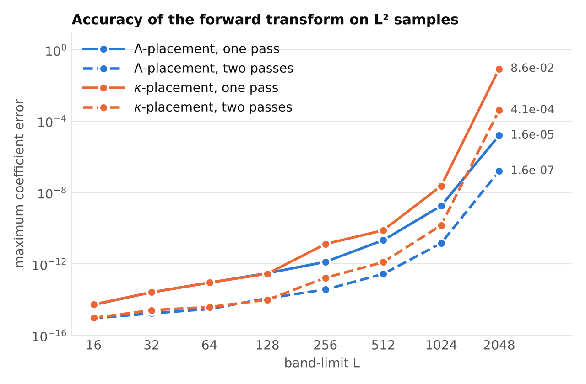
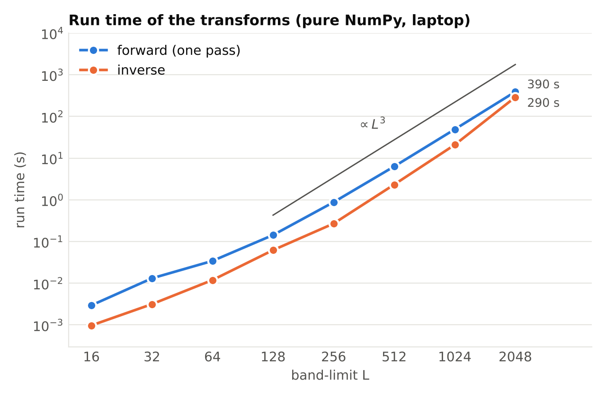

# osht

**Spherical harmonic transforms on optimal-dimensionality (L²) samples.**

[](https://github.com/zubairkhalid1/osht/actions/workflows/tests.yml)
[](https://zubairkhalid1.github.io/osht)
[](https://pypi.org/project/osht/)
[](https://pypi.org/project/osht/)
[](LICENSE)
[](https://arxiv.org/abs/2611.16441)

`osht` computes forward and inverse spherical harmonic transforms of a signal
band-limited at L from exactly L² samples on the sphere, the number of degrees
of freedom of such a signal. The samples lie on L iso-latitude rings, ring k
carrying 2k+1 equally spaced samples (the optimal-dimensionality sampling
scheme of Khalid, Kennedy and McEwen, 2014). The forward transform is the
*interpolated elimination*: an O(L³) sweep over the orders that never solves a
linear system and needs no precomputation beyond the ring co-latitudes,
followed by an exact back-end. The inverse transform is a closed-form synthesis
by folded inverse FFTs. Everything is pure NumPy and SciPy.

The method is described in the paper "An O(L³) spherical harmonic transform on
L² samples" ([arXiv:2611.16441](https://arxiv.org/abs/2611.16441)).

```python
import numpy as np, osht

L = 64
flm = osht.random_flm(L, rng=0)      # coefficients f_l^m at flm[l**2 + l + m]
f = osht.inverse(flm, L)             # L**2 samples, stored ring by ring
flm_rec = osht.forward(f, L)         # interpolated elimination, two passes
print(osht.errors(flm, flm_rec).E_max)   # about 4e-15
```

## Features

- **L² samples**, the smallest number any sampling theorem can use, with
  transforms that are exact in exact arithmetic.
- **O(L³) forward transform** by interpolated elimination with the order-m
  sampling functions of Giacaglia and Lundquist (1972), evaluated in a stable
  log-domain barycentric form; no linear solves, no stored factors.
- **Two exact back-ends**: the equiangular pipeline of McEwen and Wiaux (2011)
  and Gauss-Legendre quadrature of the interpolated profiles.
- **Multi-pass refinement** by residual iteration with an automatic stopping
  rule: about 4e-14 at L = 256, 3e-13 at L = 512 and 1.5e-11 at L = 1024.
- **Ring placements optimised for stability**: the Λ-placement (stored for
  L ≤ 128 and L = 256, 512, 1024, 1536, 2048) and the κ-placement of the NSHT
  package (L ≤ 721 and L = 1024, 1536, 2048), plus the greedy searches that
  produce them.
- **Any band-limit**: for an L without a shipped placement, the greedy search
  runs once (`osht.ordered_theta(L, search=True)`), its result is saved in a
  user cache and reused by every later call.
- **Real-signal fast path, batches of signals**, the linear-solve transform of
  the 2014 paper as a reference, amplification constants, error measures,
  sampling functions and plotting helpers.

## Installation

```bash
pip install osht            # NumPy and SciPy only
pip install "osht[plot]"    # with matplotlib for the plotting helpers
```

Python 3.9 or later. For development: `pip install -e ".[dev]"` and `pytest`.

## Usage

```python
import osht

L = 128
s = osht.Sampling(L)                 # the scheme: s.thetas (rings), s.theta, s.phi (every sample)
f = my_function(s.theta, s.phi)      # sample your own signal on the L**2 points

flm = osht.forward(f, L)             # default: Lambda-placement, equiangular back-end, two passes
flm = osht.forward(f, L, backend="gl", passes=1)        # Gauss-Legendre back-end, single pass
flm = osht.forward(f.real, L, reality=True)             # real signal: half the work
flm = osht.forward(f, L, thetas="kappa")                # the placement of the NSHT package
flm, info = osht.forward(f, L, return_info=True)        # amplification constants, residuals

f = osht.inverse(flm, L)             # synthesis on the samples
flm_lu = osht.forward_lu(f, L)       # the 2014 transform by linear solves (reference, O(L^4))

amp = osht.amplification(L, kappa=True)   # Lambda_m, Lambda_m^GL, kappa(P_m) of the placement
th = osht.ordered_theta(150, search=True)  # no shipped placement at L = 150: search once, cached afterwards
```

Coefficients are stored as `flm[l**2 + l + m]` (`osht.elm2ind`,
`osht.ind2elm`); samples are stored ring by ring, ring k at the positions
`k**2 .. (k+1)**2 - 1` (`osht.ring_slice`). Batches have shape `(S, L**2)`.

See the [documentation](https://zubairkhalid1.github.io/osht) for the method,
the accuracy and stability measurements, the placements and the API.

## Demos

The `demos/` folder has runnable scripts; each takes the band-limit or its
options on the command line and prints what it measures.

| Script | Shows |
| --- | --- |
| `demo01_quickstart.py` | a round trip with both back-ends, one and two passes, and the linear-solve reference |
| `demo02_real_signal_earth.py` | the Earth topography with the real-signal fast path, with plots |
| `demo03_placements_and_amplification.py` | the three ring placements, their amplification constants and accuracy |
| `demo04_multipass_and_oracle.py` | the multi-pass refinement and the oracle sweep |
| `demo05_sampling_functions_and_new_L.py` | the sampling functions, and a band-limit without a shipped placement (search once, cached) |
| `demo06_batch_and_timing.py` | batches of signals and timings of all transforms |
| `demo07_runtime_vs_L.py` | run time of one forward pass and one inverse for L = 16 to 2048 |
| `demo08_accuracy_vs_L.py` | accuracy after one and two passes for L = 16 to 2048, Λ- against κ-placement (resumable) |

Demos 7 and 8 are the experiments of the
[paper](https://arxiv.org/abs/2611.16441); their stored numerical results
and the commands that reproduce them and draw the figures are in
[`paper/`](paper/).

## Accuracy and run time

Spectral-spatial-spectral round trips on random complex signals with the
Λ-placement and the equiangular back-end (mean over five signals of the
maximum coefficient error; times of one forward pass and one inverse on a
laptop, pure NumPy):

| L | one pass | two passes | forward pass | inverse |
| --- | --- | --- | --- | --- |
| 64 | 9e-14 | 3e-15 | 0.03 s | 0.01 s |
| 256 | 1.3e-12 | 4e-14 | 0.9 s | 0.3 s |
| 512 | 2.2e-11 | 3e-13 | 6 s | 2 s |
| 1024 | 1.8e-9 | 1.5e-11 | 49 s | 21 s |
| 2048 | 1.6e-5 | 1.6e-7 | 6.5 min | 4.8 min |

<p align="center">
  
  
</p>

The error grows with L because the samples carry no redundancy; the
[stability page](https://zubairkhalid1.github.io/osht/stability.html) of the
documentation explains the mechanism and the role of the ring placement.

## Related packages

`osht` is for the case of exactly L² samples (scalar signals). For redundant
sampling schemes (equiangular, Gauss-Legendre, HEALPix) and for spin
transforms, see [SSHT / pyssht](https://github.com/astro-informatics/ssht),
[s2fft](https://github.com/astro-informatics/s2fft),
[ducc0](https://gitlab.mpcdf.mpg.de/mtr/ducc),
[pyshtools](https://github.com/SHTOOLS/SHTOOLS) and
[healpy](https://github.com/healpy/healpy). The MATLAB package NSHT
implements the original 2014 transform on the same samples; its placements
are shipped here as `thetas="kappa"`.

## Citation

If you use `osht`, please cite

```bibtex
@article{khalid2026osht,
  author        = {Khalid, Zubair},
  title         = {An {$O(L^3)$} spherical harmonic transform on {$L^2$} samples},
  journal       = {arXiv preprint arXiv:2611.16441},
  year          = {2026},
  eprint        = {2611.16441},
  archivePrefix = {arXiv},
  doi           = {10.48550/arXiv.2611.16441},
  url           = {https://arxiv.org/abs/2611.16441}
}

@article{khalid2014optimal,
  author  = {Khalid, Zubair and Kennedy, Rodney A. and McEwen, Jason D.},
  title   = {An optimal-dimensionality sampling scheme on the sphere with fast spherical harmonic transforms},
  journal = {IEEE Transactions on Signal Processing},
  volume  = {62},
  number  = {17},
  pages   = {4597--4610},
  year    = {2014},
  doi     = {10.1109/TSP.2014.2337278}
}
```

and the software itself through the `CITATION.cff` file (GitHub shows a
"Cite this repository" button).

## Contributing

Bug reports, questions and pull requests are welcome; see
[CONTRIBUTING.md](CONTRIBUTING.md).

## License

MIT License, see [LICENSE](LICENSE). The equiangular back-end follows the
algorithm of McEwen and Wiaux (2011) and the Wigner plane recursion is a
rewrite of `dl_trapani_full` from Jason McEwen's SSHT package; the stored
κ-placements come from the NSHT package.
